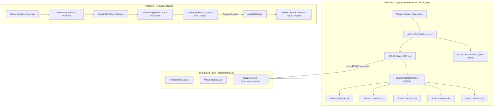

# Heirloom: Trust-Minimized Digital Inheritance Protocol

> **Your digital legacy should not depend on a single person.**

Heirloom is a trust-minimized digital inheritance protocol built as a **working prototype / hackathon implementation** for **BNB Smart Chain (Chain ID: 97)**. It securely transfers protected digital assets—such as encrypted documents, credentials, cryptocurrency master keys, personal records, and wills—to designated beneficiaries only after predefined owner inactivity conditions and independent threshold attestations are satisfied on-chain.

---

## 📌 Problem Statement

People increasingly hold critical digital assets including encrypted credentials, private keys, financial records, and medical directives. If the owner dies or becomes permanently unavailable, legitimate heirs have no reliable way to recover these assets. At the same time, relying on a simple inactivity timer creates severe risk of premature disclosure.

Heirloom solves this by enforcing multi-party threshold attestation ($k$ of $n$) combined with an emergency owner challenge window before any asset key can be released.

---

## 🛡️ Cryptographic Architecture

**DO NOT store plaintext secrets or sensitive files directly on-chain.**

Sensitive assets are encrypted off-chain using:
$$\text{Plaintext Payload} \xrightarrow{\text{AES-256-GCM}} \text{Encrypted Ciphertext (IPFS / Storage Node)}$$
$$\text{Master 256-bit AES Key} \xrightarrow{\text{Shamir Secret Sharing } GF(256)} \text{5 Key Shares (Threshold: 3 of 5)}$$

The blockchain stores **ONLY**:
- Hash commitments (`keccak256(masterAESKey)`)
- Fragment commitments (`keccak256(share_i)`)
- Metadata, beneficiary addresses, timestamps, threshold state, and immutable audit logs.

---

## 🏗️ Protocol Architecture & Recovery Lifecycle



---

## ⚡ Technology Stack

- **Smart Contracts**: Solidity `^0.8.20`, Hardhat, OpenZeppelin Contracts, BNB Smart Chain Testnet (Chain ID 97) / Hardhat Localnet (31337).
- **Frontend Dashboard**: Next.js 16 (App Router), React 19, TypeScript, Tailwind CSS, Framer Motion, Lucide Icons, wagmi, viem, ethers.
- **Off-Chain Cryptography**: Web Crypto API (`crypto.subtle` AES-256-GCM), Shamir Secret Sharing over $GF(256)$ ($x^8 + x^4 + x^3 + x + 1$, $0x11b$).
- **Storage Layer**: Off-chain IPFS CID storage with local fallback simulation.
- **Testing**: Hardhat, Chai, TypeScript unit & integration test suite (20 contract tests + 6 crypto tests).

---

## ⏱️ Demo Mode vs. Production Configuration

Judges do not need to wait 180 days to test the protocol. Heirloom features a safe **Demo Mode**:

| Parameter | Production Mode | Demo Mode |
| :--- | :--- | :--- |
| **Inactivity Period** | 180 Days ($15,552,000\text{s}$) | **60 Seconds** |
| **Challenge Period** | 7 Days ($604,800\text{s}$) | **30 Seconds** |
| **Attestor Threshold** | 3 of 5 Approvals | **3 of 5 Approvals** |

---

## 🚀 Deployment Addresses & BNB Testnet Information

### Local Hardhat Deployment (Chain ID: 31337)
- **AttestorRegistry**: `0x5FbDB2315678afecb367f032d93F642f64180aa3`
- **HeirloomRegistry**: `0xe7f1725E7734CE288F8367e1Bb143E90bb3F0512`
- **KeyEscrow**: `0x9fE46736679d2D9a65F0992F2272dE9f3c7fa6e0`

### BNB Smart Chain Testnet (Chain ID: 97)
- **RPC URL**: `https://data-seed-prebsc-1-s1.binance.org:8545`
- **Explorer**: [https://testnet.bscscan.com](https://testnet.bscscan.com)
- Deployment Script: `npm run deploy:testnet`

---

## 💻 Quickstart & Setup Commands

```bash
# 1. Install dependencies
npm install

# 2. Run unit & security tests (20 contract tests + 6 crypto tests)
npm test

# 3. Build production web app
npm run build

# 4. Deploy smart contracts locally
npm run deploy:local

# 5. Launch web app & demo dashboard
npm run dev
# or
npm run demo
```

---

## ⚠️ Security Limitations & Future Roadmap

As a hackathon prototype / proof-of-concept:
1. **IPFS Node Persistence**: Currently relies on local fallback storage simulation. Production requires decentralized IPFS pinning (e.g. Pinata / Filecoin).
2. **Attestor Identity Verification**: Attestors in this MVP are wallet-address abstractions. Production will integrate zk-TLS, DID, or oracle attestations.
3. **Hardware Enclaves**: Key share delivery can be hardened using TEE (Trusted Execution Environments).
