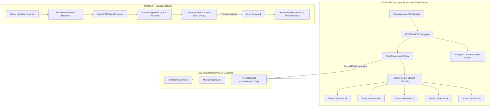

# Heirloom: Trust-Minimized Digital Inheritance Protocol

> **Your digital legacy should not depend on a single person.**

Heirloom is a decentralized, trust-minimized digital inheritance protocol built for **BNB Smart Chain (Chain ID: 97)**. It securely transfers protected digital assets—such as encrypted documents, credentials, cryptocurrency master keys, personal records, and wills—to designated beneficiaries only after predefined owner inactivity/unavailability conditions and independent threshold attestations are satisfied.

---

## 🛡️ Core Security Principle

**DO NOT store plaintext secrets or sensitive files directly on-chain.**

Sensitive assets are encrypted off-chain using:
$$\text{Plaintext Payload} \longrightarrow \text{AES-256-GCM} \longrightarrow \text{Ciphertext (Stored on IPFS / Local Node)}$$
$$\text{AES Encryption Key} \longrightarrow \text{Shamir Secret Sharing } GF(256) \longrightarrow \text{5 Key Shares (Threshold: 3 of 5)}$$

The blockchain stores **ONLY**:
- Hash commitments (`keccak256(masterAESKey)`)
- Fragment commitments (`keccak256(share_i)`)
- Timestamps, threshold state, beneficiary addresses, and immutable audit logs.

---

## 🏗️ Protocol Architecture



---

## ⚡ Technology Stack

- **Smart Contracts**: Solidity `^0.8.20`, Hardhat, OpenZeppelin Contracts, BNB Smart Chain Testnet (Chain ID 97) / Hardhat Localnet (31337).
- **Frontend Dashboard**: Next.js 16 (App Router), React 19, TypeScript, Tailwind CSS, Framer Motion, Lucide Icons, wagmi, viem.
- **Off-Chain Cryptography**: Web Crypto API (`crypto.subtle` AES-256-GCM), Shamir Secret Sharing over $GF(256)$ with primitive polynomial $x^8 + x^4 + x^3 + x + 1$ ($0x11b$).
- **Storage Layer**: Off-chain IPFS CID storage with local fallback simulation.
- **Testing**: Hardhat, Chai, TypeScript unit & integration test suite (20 core test scenarios).

---

## 📜 Smart Contracts Overview

- **`HeirloomRegistry.sol`**: Core protocol contract managing digital asset records, liveness heartbeat, inactivity detection, attestation approval tracking, emergency challenge countdown, and asset finalization.
- **`AttestorRegistry.sol`**: Manages independent recovery attestor registration and authorizations. Enforces that no single attestor can unilaterally release an asset.
- **`KeyEscrow.sol`**: Manages cryptographic hash commitments (`keccak256`) of key fragments off-chain. Never exposes plaintext keys on-chain.

---

## ⏱️ Demo Mode vs. Production Configuration

Judges do not need to wait 180 days to verify the protocol. Heirloom features a safe **Demo Mode**:

| Parameter | Production Mode | Demo Mode |
| :--- | :--- | :--- |
| **Inactivity Period** | 180 Days ($15,552,000\text{s}$) | **60 Seconds** |
| **Challenge Period** | 7 Days ($604,800\text{s}$) | **30 Seconds** |
| **Attestor Threshold** | 3 of 5 Approvals | **3 of 5 Approvals** |

---

## 🚀 Quickstart & Local Setup

### 1. Prerequisites
- Node.js `v22+`
- npm `v9+`

### 2. Clone Repository & Install Dependencies
```bash
git clone https://github.com/PremB2907/Bnb26_Winning-Team_Internal_Round.git
cd Bnb26_Winning-Team_Internal_Round
npm install
```

### 3. Compile Smart Contracts
```bash
npm run compile
```

### 4. Run Smart Contract & Cryptographic Unit Tests
```bash
npm test
```
*Executes all 20 requirement test scenarios and cryptographic SSS & AES-256-GCM unit tests.*

### 5. Deploy Contracts Locally
```bash
npm run deploy:local
```
*Deploys `AttestorRegistry`, `HeirloomRegistry`, `KeyEscrow` and updates `src/contracts/deployed.json`.*

### 6. Launch Web Dashboard
```bash
npm run dev
```
Open [http://localhost:3000](http://localhost:3000) in your browser.

---

## 🌐 Deploying to BNB Smart Chain Testnet (Chain ID: 97)

1. Copy `.env.example` to `.env`:
   ```bash
   cp .env.example .env
   ```
2. Set your private key with testnet BNB:
   ```env
   PRIVATE_KEY=0xYourPrivateKeyHere...
   BSC_TESTNET_RPC=https://data-seed-prebsc-1-s1.binance.org:8545
   ```
3. Deploy to BNB Testnet:
   ```bash
   npm run deploy:testnet
   ```

---

## 📋 Security & Threat Model Documentation

For detailed cryptographic proofs, threat matrices, and mitigation strategies, see:
- [docs/SECURITY.md](docs/SECURITY.md) - Cryptographic Architecture & Audit Details
- [docs/THREAT_MODEL.md](docs/THREAT_MODEL.md) - Threat Matrix & Attack Vector Analysis

---

## ✅ Definition of Done Checklist

- [x] Smart contracts compile cleanly with Solidity 0.8.20 and `viaIR` optimization
- [x] 20 hardhat unit test scenarios pass 100%
- [x] Cryptographic SSS over GF(256) and WebCrypto AES-256-GCM tests pass
- [x] Local contract deployment works and saves `deployed.json`
- [x] Asset registration pipeline works client-side
- [x] Owner heartbeat liveness tracking works
- [x] Recovery initiation & evidence submission work
- [x] 3 of 5 threshold attestation works
- [x] Emergency owner challenge cancellation works
- [x] Final asset release and key reconstruction work
- [x] Next.js dashboard compiles cleanly for production build
